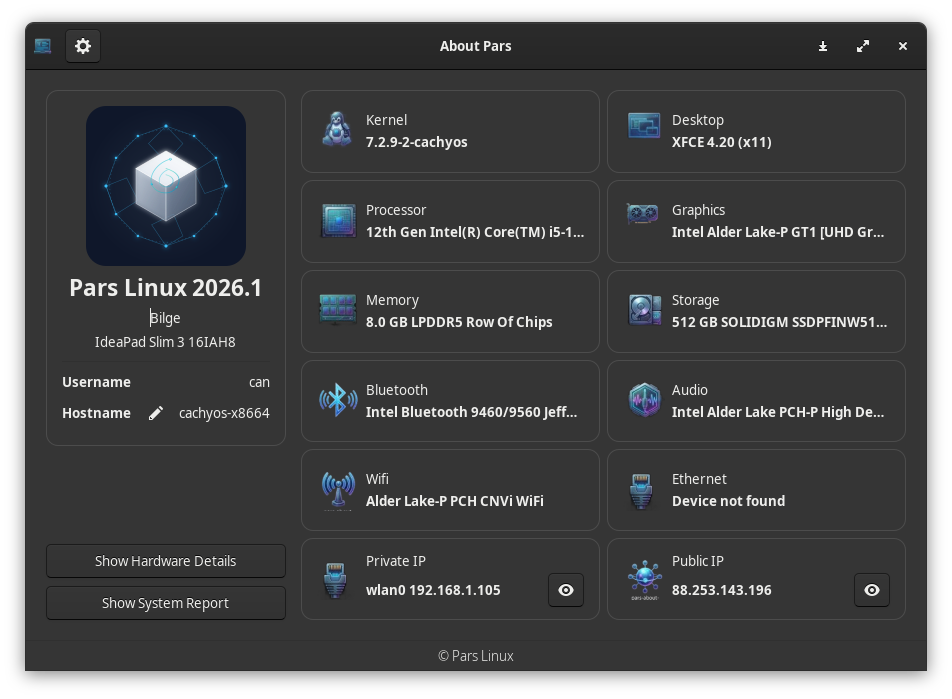
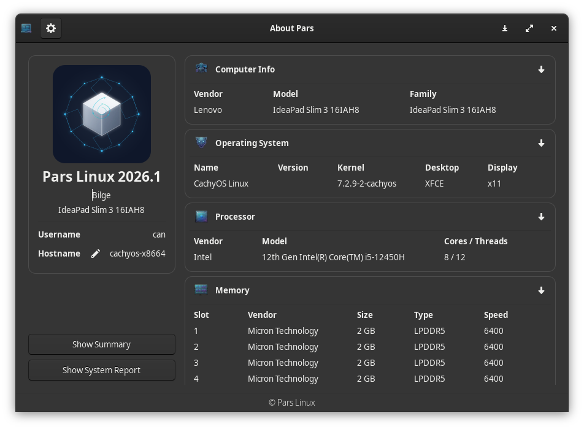
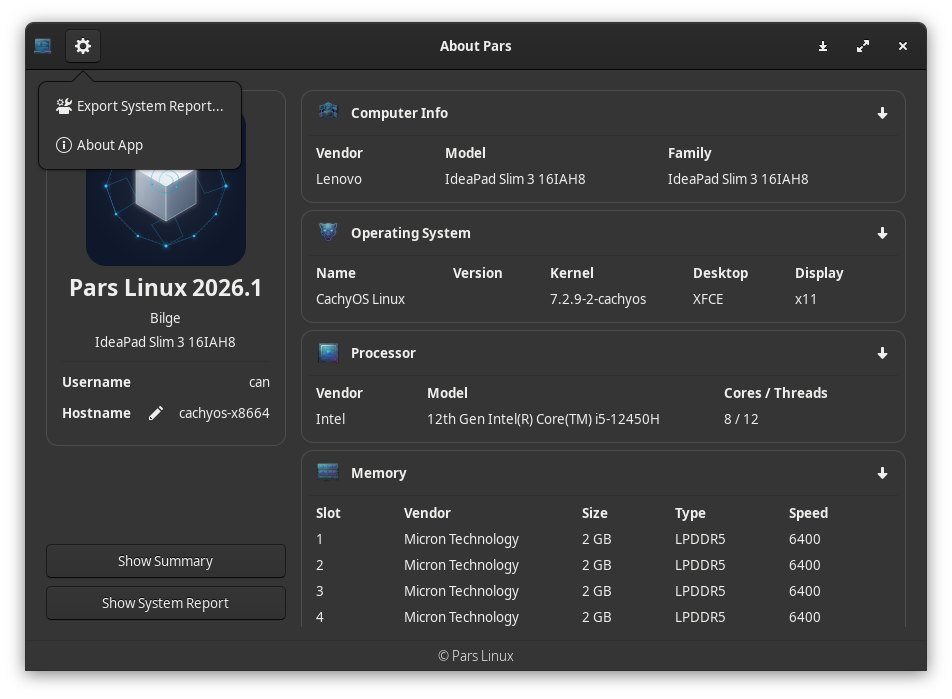

# Pars About

Pars About (`org.parslinux.about`), Pars Linux ve GNU/Linux sistemler için geliştirilmiş, sistem özeti ve ayrıntılı donanım bilgilerini hem kullanıcı dostu modern bir grafik arayüzde (GTK+ 3) hem de uçbirim üzerinden makine tarafından okunabilir saf JSON çıktısı (Headless CLI) olarak sunan sistem inceleme aracıdır.

[](https://repology.org/project/pars-about/versions)
[](LICENSE)

---

### 📸 Ekran Görüntüleri (Screenshots)







---

### ✨ Temel Özellikler

* **Kapsamlı Sistem Özeti**: İşletim sistemi, çekirdek sürümü, masaüstü ortamı, işlemci, grafik yongası, RAM ve depolama alanı özeti.
* **Ayrıntılı Donanım Analizi**: İşlemci (CPU), Bellek (RAM), Ekran Kartı (GPU), Diskler, Monitörler (EDID çözümü), Ses aygıtları, Ağ kartları (Ethernet / Wi-Fi), Bluetooth, USB aygıt ağacı, PCI veriyolu, Giriş aygıtları, Web kamerası ve Biyometri desteği.
* **Özgün Vektörel İkon Seti**: Tüm donanım kategorileri için özel olarak tasarlanmış modern Pars Linux SVG simgeleri.
* **Headless CLI (`--json` / `-j`)**: X11 veya Wayland grafik sunucusu gerektirmeden uçbirim üzerinden tam donanım dökümünü JSON olarak alma; otomasyon ve uzaktan envanter yönetimi desteği.
* **Doğrudan Donanım Modu (`--hardware` / `-h`)**: Doğrudan donanım bileşenleri sekmesini açabilme.
* **Sistem Teşhis Raporu**: Destek ve arıza tespiti için sistem günlüklerini ve donanım bilgilerini tek tıkla masaüstüne `.tar.gz` olarak arşivleme.
* **Güvenli Yetkilendirme**: PolicyKit (`pkexec`) ile korunan en az yetki modeli; arayüzün standart kullanıcı haklarıyla çalışması.

---

### 📦 Bağımlılıklar (Dependencies)

**Debian / Pars Linux / Ubuntu:**
```bash
sudo apt update
sudo apt install -y \
    python3 python3-gi python3-requests python3-cairosvg python3-cups \
    gir1.2-gtk-3.0 gir1.2-glib-2.0 gir1.2-gudev-1.0 gir1.2-soup-2.4 \
    mesa-utils pciutils lsb-release hwdata dconf-cli pkexec \
    meson ninja-build gettext
```

**Arch Linux:**
```bash
sudo pacman -Syu --needed \
    python python-gobject python-requests python-cairosvg pycups \
    gtk3 glib2 libgudev libsoup3 mesa-utils pciutils lsb-release \
    hwdata dconf polkit meson ninja gettext
```

---

### 🚀 Hızlı Başlangıç (Quick Start)

Projede çalıştırma, bağımlılık kontrolü, kurma, kaldırma ve paketleme işlemlerini tek bir merkezden yönetmek için betikler hazırlanmıştır:

#### 🛠️ Yönetim Merkezi (İnteraktif Menü ve Komutlar)
```bash
# İnteraktif terminal menüsünü açma:
./manage.sh

# Doğrudan komut satırından işlem yürütme:
./manage.sh run          # GUI arayüzünü başlatır
./manage.sh run-hw       # Donanım sekmesini açar
./manage.sh run-json     # Headless CLI modunda JSON çıktısı üretir
./manage.sh deps         # Bağımlılıkları kontrol eder ve eksikleri kurar
./manage.sh install      # Meson & Ninja ile sisteme (/usr) kurar
./manage.sh uninstall    # Sistemden tamamen kaldırır
./manage.sh package      # Dağıtıma göre paketler (Arch: .pkg.tar.zst / Debian: .deb)
./manage.sh test         # Test paketini çalıştırır
./manage.sh clean        # Derleme ve önbellek artıklarını temizler
```

#### ⚡ Hızlı Kısayol Betikleri
```bash
# 1. Çalıştırma
./run.sh                 # Normal GUI
./run.sh --hardware      # Donanım sekmesi
./run.sh --json          # JSON çıktısı

# 2. Kurulum
./install.sh             # Derler ve /usr altına kurar

# 3. Kaldırma
./uninstall.sh           # Sistemden temizler

# 4. Paketleme
./package.sh             # Otomatik tespit veya menü
./package.sh arch        # Arch Linux paketi (.pkg.tar.zst)
./package.sh deb         # Debian paketi (.deb)
./package.sh tar         # Kaynak kod arşivi (.tar.gz)
```

---

### 📚 Dokümantasyon (Documentation)

Proje hakkındaki tüm detaylı kılavuzlar `docs/` dizini altında toplanmıştır:

| Kılavuz | Açıklama |
|:---|:---|
| [Dokümantasyon Dizini (INDEX.md)](docs/INDEX.md) | Tüm belgelerin merkezi dizini |
| [Mimari (ARCHITECTURE.md)](docs/ARCHITECTURE.md) | Dahili mimari, bileşen şeması ve veri akışı |
| [Fork Notları (FORK.md)](docs/FORK.md) | Pardus'tan çatallanma süreci ve Pars Linux dönüşümü |
| [Geliştirici Yönergesi (CLAUDE.md)](docs/CLAUDE.md) | Geliştirici kuralları, GTK standartları ve komutlar |
| [Uçbirim Referansı (CLI_REFERENCE.md)](docs/CLI_REFERENCE.md) | `--json`, `--hardware` ve `jq` otomasyon komutları |
| [Kurulum Kılavuzu (INSTALL.md)](docs/INSTALL.md) | Bağımlılıklar, kaynak koddan derleme ve .deb oluşturma |
| [Değişiklik Günlüğü (CHANGELOG.md)](docs/CHANGELOG.md) | Sürüm geçmişi ve yapılan geliştirmeler |
| [Test Kılavuzu (TESTING.md)](docs/TESTING.md) | Headless testler, duman testleri ve doğrulama |
| [Çeviri Kılavuzu (TRANSLATION_GUIDE.md)](docs/TRANSLATION_GUIDE.md) | GNU gettext çeviri süreci ve yeni dil ekleme |
| [Katkı Rehberi (CONTRIBUTING.md)](docs/CONTRIBUTING.md) | Hata bildirimi ve Git geliştirme iş akışı |
| [Masaüstü Entegrasyonu (UYGULAMA_BAGLAMA.md)](docs/UYGULAMA_BAGLAMA.md) | XDG kısayolları ve Ayarlar Yöneticisi bağlama |
| [Veri Tasarrufu (DATA_SAVING_GUIDE.md)](docs/DATA_SAVING_GUIDE.md) | Çevrimdışı çalışma, sıfır ağ kullanımı ve gizlilik |
| [Kurumsal Barındırma (SELF_HOSTING_GUIDE.md)](docs/SELF_HOSTING_GUIDE.md) | Merkezi donanım envanteri toplama ve yerel depo |
| [Kullanım Şartları (TERMS.md)](docs/TERMS.md) / [SARTLAR.md](docs/SARTLAR.md) | Kullanım şartları ve garanti reddi |
| [Sürüm Politikası (VERSION.md)](docs/VERSION.md) | SemVer sürümleme mantığı ve yayın döngüsü |
| [Flatpak Paketleme (FLATPAK_PACKAGING_GUIDE.md)](docs/FLATPAK_PACKAGING_GUIDE.md) | Sandbox izinleri ve Flatpak manifestosu |
| [Güvenlik Politikası (SECURITY.md)](docs/SECURITY.md) | Güvenlik modeli, PolicyKit yetkileri ve bildirim |
| [Ödeme Kapsamı (PAYMENT_INTEGRATION.md)](docs/PAYMENT_INTEGRATION.md) | Lisanslama ve ticari model kapsamı (GPL-3.0+) |
| [Proje İlerlemesi (progress.md)](docs/progress.md) | Kilometre taşları ve gelecek sürüm hedefleri |

---

### 📄 Lisans (License)

Pars About, **GNU Genel Kamu Lisansı sürüm 3 veya daha yenisi (GPL-3.0+)** ile lisanslanmıştır. Ayrıntılar için [LICENSE](LICENSE) dosyasına bakınız.
